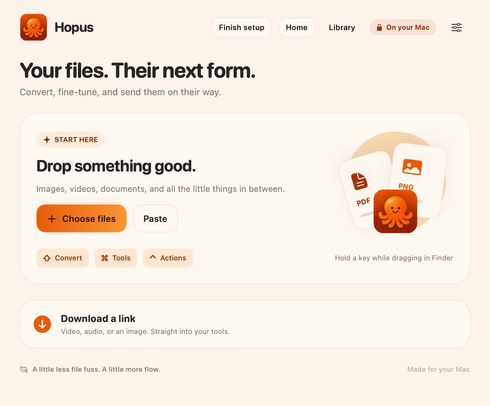
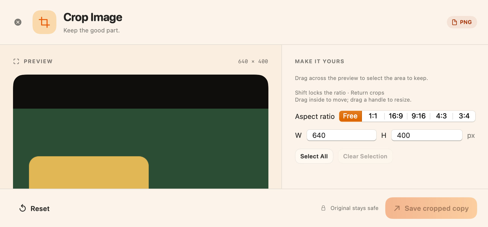
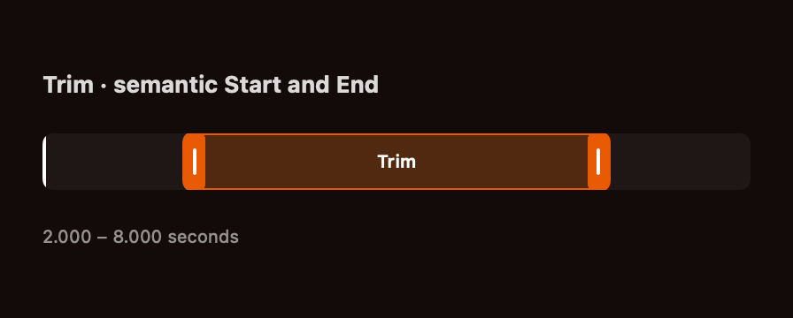
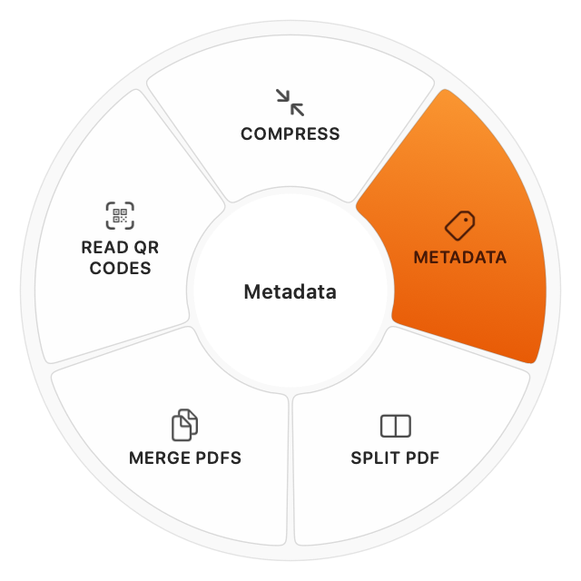

<p align="center"></p>
<h1 align="center">Hopus</h1>
<p align="center">Your files, a little brighter. · Dosyaların için turuncu bir kolaylık.</p>

[Latest release](https://github.com/atakansahinbalta/hopus/releases/latest) · [Security](SECURITY.md)

Hopus is an independent, open-source file conversion and editing app for macOS. Drag a file, spin the wheel, and convert, crop, trim, or download public media. Files stay on your Mac. Hopus is not affiliated with Tangerine or LEAP STUDIO.

## See Hopus in action

[](docs/assets/showcase/hopus-octopus-demo.mp4)

**[Watch the 9-second walkthrough](docs/assets/showcase/hopus-octopus-demo.mp4)** · [Türkçe](README.tr.md)

Home, the tools wheel, image crop, and the trim range. The captures use generated fixtures. English and Turkish captions are in the video.

| macOS · Home | macOS · Crop image |
| :---: | :---: |
| [](docs/assets/showcase/hopus-octopus-home.png) | [](docs/assets/showcase/hopus-crop.png) |
| **macOS · Trim range** | **macOS · Tools wheel** |
| [](docs/assets/showcase/hopus-trim.png) | [](docs/assets/showcase/hopus-wheel.png) |

## Download and use

- **[macOS ZIP · Apple Silicon, macOS 13+](https://github.com/atakansahinbalta/hopus/releases/latest/download/Hopus-macOS-arm64.zip):** extract, move Hopus.app to your Applications folder and open it. The full macOS catalog has 27 tools, 46 input formats and 276 conversion routes. If macOS says the app is from an unidentified developer, right-click Hopus and choose Open.
- **Windows:** source and build notes are in [windows/README.md](windows/README.md). This release publishes the Mac app.

First launch guides you through **Finish setup → Download missing tools** for hash-verified downloads directly from upstream. Media and Office tools install in sequence; existing tools are kept, and cancelled or failed setup can be retried. **Tools ready** appears only when both groups are available. Core native image/PDF features work immediately. [Exact versions, hashes and licenses](docs/dependencies.md).

These first public builds do not have Apple notarization or Windows Authenticode publisher signing. Your OS may require first-launch approval; consult [Apple's guidance](https://support.apple.com/en-us/102445). Hopus does not disable system security settings. Official release assets include SHA-256 checksums. A CI artifact alone is not an official signed update.

## Shortcuts

On macOS, hold **Shift** while dragging in Finder for conversion, **Command** for tools or **Control** for file actions. **Control–Shift–D** downloads a copied public link. Drag modifiers are customizable. On Windows, use **Ctrl+O** to choose files, **Ctrl+V** to import copied files/text/images, and **Ctrl+Space** for the tools and conversion wheel. **Ctrl+2** opens Library; **Ctrl+F** searches it. Normal paste inside text fields is preserved. Home and Library share the Mac color palette, rounded cards and gold actions, with System/Light/Dark appearance.

Supported media editors use **Space** for play/pause, **Left/Right** to seek one second and **I/O** to mark a range. Crop uses drag, **Shift** for aspect lock and **Enter** to save. The [Windows guide](windows/README.md) lists its available controls.

## Build

For macOS: Apple Silicon, macOS 13+ and Xcode/Swift 6.

```sh
scripts/setup-exiftool.sh
swift build --product Hopus
swift test --filter HopusUpdatesTests
scripts/build-app.sh release
```

The public app is written to `build/Hopus.app`. Large runtimes are installed through its setup screen. Source builds use an ad-hoc signature unless you provide your own ignored signing profile. Signing private keys are never distributed. [Windows build instructions](windows/README.md).

## Privacy and updates

Conversion/editing run locally. Web downloads contact the selected media site. No analytics, cloud account or browser-cookie import is built in. Official releases update through this public repository without a GitHub account or token. macOS verifies the signed feed and archive; Windows verifies the archive signature and version before replacement. Active operations finish or cancel before the app exits for an update. Portable Windows updates retain the previous folder as a recoverable backup.

## License and acknowledgments

The original source and this Hopus fork are [MIT](LICENSE). Vendored libraries and external tools retain their own licenses; see [macOS notices](Resources/THIRD-PARTY-NOTICES.txt), [Windows notices](windows/THIRD-PARTY-NOTICES.txt) and [runtime setup](docs/dependencies.md). No purchase flow or reference-app account is required.
