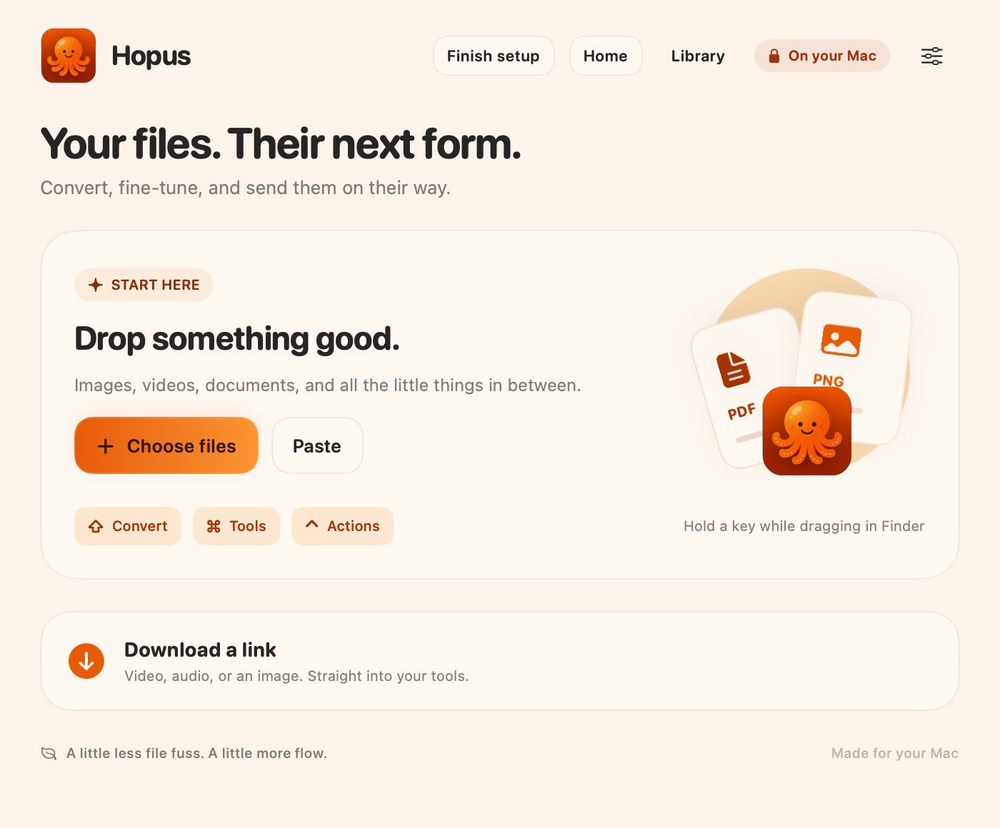
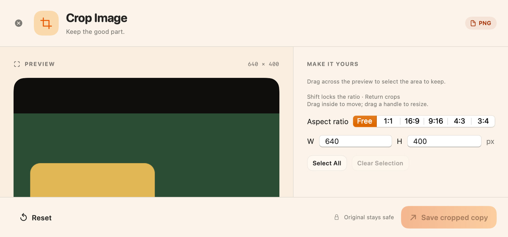
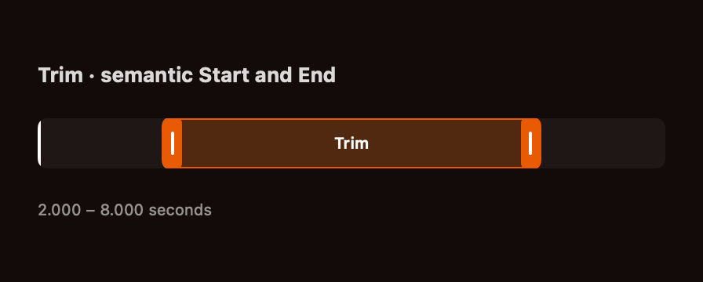
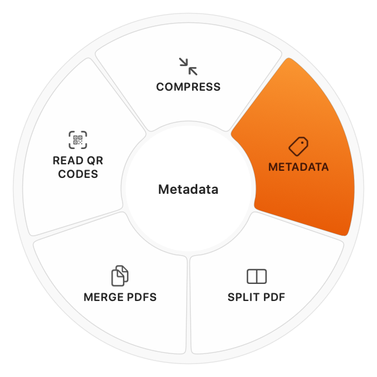

# Hopus

[English](README.md) · [Son sürüm](https://github.com/atakansahinbalta/hopus/releases/latest)

Hopus, sürükle ve çark etkileşimiyle çalışan bağımsız, açık kaynaklı bir dosya dönüştürme ve düzenleme uygulamasıdır. Web’den medya indirme, QR okuma, geliştirilmiş crop/annotate araçları, klavyeyle medya düzenleme, canlı ilerleme ve imzalı otomatik güncelleme ekler. Tangerine veya LEAP STUDIO ile bağlantılı değildir; referans uygulamanın binary dosyaları veya görselleri dağıtılmaz.

## Hopus’u iş başında gör

**[9 saniyelik anlatımı izle](docs/assets/showcase/hopus-octopus-demo.mp4)**

Ana ekran, araç çarkı, görsel kırpma ve kırpma aralığı. Görüntüler üretilmiş örnek dosyalarla alındı. Video oynatıcıda Türkçe ve İngilizce altyazı bulunur.

| macOS · Ana ekran | macOS · Görsel kırp |
| :---: | :---: |
|  |  |
| **macOS · Kırpma aralığı** | **macOS · Araç çarkı** |
|  |  |

## İndir ve kullan

- **[macOS ZIP · Apple Silicon, macOS 13+](https://github.com/atakansahinbalta/hopus/releases/latest/download/Hopus-macOS-arm64.zip):** ZIP’i aç, Hopus.app’i Uygulamalar klasörüne taşı ve aç. macOS ilk açılışta onay isterse Hopus’a sağ tıklayıp Aç’ı seç. macOS kataloğu 28 araç, 46 girdi formatı ve 276 dönüşüm yolu içerir.
- **Windows:** kaynak ve derleme notları [windows/README.md](windows/README.md) içindedir. Bu sürüm Mac uygulamasını yayınlar.

İlk açılışta **Kurulumu tamamla → Eksik araçları indir** akışı Medya ve Office araçlarını sırayla kurar. Bilgisayarında bulunan araçlar yeniden indirilmez; iptal veya hata sonrasında yalnızca eksik gruplarla devam edilir. **Araçlar hazır** durumu iki grup da kullanılabilir olduğunda gösterilir. İndirmeler doğrudan upstream’den gelir; hash’leri kurulumdan önce doğrulanır. Temel yerel görsel/PDF işlemleri hemen çalışır. [Sürümler, hash’ler ve lisanslar](docs/dependencies.md).

İlk public build’lerde Apple notarization / Windows Authenticode yayıncı imzası bulunmuyor. İşletim sistemi ilk açılışta onay isteyebilir. Hopus sistem güvenlik ayarlarını kapatmaz. Resmi yayınlarda SHA-256 dosyası vardır; her CI çıktısı resmi imzalı güncelleme sayılmaz.

## Kısayollar

macOS’ta Finder’da sürüklerken **Shift** dönüşüm, **Command** araçlar, **Control** dosya işlemleri çarkını açar. **Control–Shift–D** kopyalanmış public linki indirir. Sürükleme tuşları özelleştirilebilir. Windows’ta **Ctrl+O** dosya seçer; **Ctrl+Space** seçili dosyaların araç ve dönüşüm çarkını açar. Çarkta **Dönüştür** ile çıktı formatını seçebilirsin. Ana sayfadaki dosya listesinde **Delete**, seçili dosyaları asıllarını silmeden Hopus’tan kaldırır.

Desteklenen medya editörlerinde **Space** oynat/duraklat, **sağ/sol ok** bir saniye ilerle/geri git, **I/O** aralık başlangıcı/sonu. Crop’ta sürükleyerek seç, **Shift** ile oranı kilitle, **Enter** ile kaydet.

Dönüştürme ve düzenleme yerelde çalışır. Web indirmeleri seçtiğin siteye bağlanır. Analytics, bulut hesabı veya tarayıcı çerezi aktarma yok. Public güncellemeler GitHub hesabı/token istemez. macOS feed ve arşiv imzasını, Windows arşiv imzasını ve sürümünü doğrular. İşler tamamlanmadan veya iptal edilmeden güncelleme için uygulama kapanmaz. Windows eski uygulama klasörünü geri alınabilir yedek olarak tutar.

Kaynak kod [MIT](LICENSE) lisanslıdır; üçüncü taraf bileşenlerin kendi lisansları geçerlidir. [macOS build adımları](README.md#build) · [Windows build adımları](windows/README.md).
